# AI-Assisted Maintenance Reporting in the Septic Industry

**A case study in constraining a language model inside a document that carries legal weight.**

---

## About this document

This is a technical case study of the AI report-generation pipeline in **SepticScribe**, a
production maintenance-management application used by onsite-wastewater contractors in British
Columbia. The pipeline takes a technician's field measurements and produces the formal maintenance
report the contractor signs and hands to the homeowner — and which a health authority may later read
in an audit.

Two things make it worth writing up:

1. The interesting engineering is **not** the language model. It is the deterministic layer built
   around it, and the deliberate decision to demote the model from *reasoner* to *writer*.
2. The regulatory context is unforgiving. A septic maintenance report is a document that can back a
   funding claim, appear in a compliance file, and carry a certified practitioner's registration
   number. The tolerance for a confident, fluent, wrong sentence is approximately zero.

**Everything stated here about the system was verified against the source at commit `a37c4d9`
(2026-07-13).** Where a number was measured, the command that produced it is given. Where a number
could not be honestly obtained, it is not reported, and the gap is named. Several genuine defects in
the system are documented below, including one that undermines the exact compliance rule this case
study argues is most important. That is deliberate: a case study whose subject has no flaws is
marketing.

**The serious defects found by this audit were fixed before it was published** (SepticScribe commits
`c391dc5` and `276cf32`, 2026-07-14): the property address, land-title parcel ID and technician name were being
sent to the model provider on every generation, unnecessarily — the product is pre-beta, so no real person's data
was in that payload, but it would have been customer PII the day it launched (§6.5);
the regulated word *"inspection"* was sitting in the few-shot exemplar the model is told to imitate,
with nothing downstream to catch it (§6.2); a deterministic guardrail was silently dead on the exact
system it was written for (§5.8); and an authoritative prompt block attributed its severity scale to a
standard it does not come from, in the wrong jurisdiction (§3.4). Each is described here as it was
found, then as it was fixed, with the measurement that supports it. **Publishing a live compliance
defect in a product that real contractors sign their registration number against would have been the
same mistake this document is about** — so the fix shipped first.

The claims in §6.2 are not just traced through the source; they were **measured**, with real model
outputs, and every one of those outputs is committed to this repository (§3.7).

**No customer data appears anywhere in this document.** Every worked example runs on a synthetic
record. No property, person, business, or credential number in this document is real.

---

## 1. Problem

### 1.1 What the work is

An onsite wastewater system — a septic system — is a small sewage treatment plant in someone's yard.
A basic one is a tank and a gravity drainfield. A modern one may include an aerated treatment unit,
an effluent pump, a control panel and float switches, an effluent filter, and a pressurized or
drip-irrigated dispersal field. It discharges treated effluent into the ground, near where people
live and drink.

These systems require periodic maintenance by a registered practitioner. The practitioner opens the
lids, takes measurements, services components, and produces a **record of that visit**. That record
is the deliverable. It is also, in practice, the only evidence that any of it happened.

The measurements are not decorative. A representative visit captures scum and sludge depth against
total fluid depth; pump current draw against the motor's nameplate full-load amperage; pressure drop
across an effluent filter; dissolved oxygen in an aerated unit; effluent clarity; liquid level
relative to the tank outlet; distal head pressures on each lateral of a low-pressure-pipe field. The
application's field registry defines **241 assessment fields across 11 component types**
(`Backend/componentInspectionRegistry.json`).

### 1.2 Who suffers, and how

**The technician** is good at tanks and bad at prose — and that is the correct allocation of their
skill. Report writing happens in a truck at 6pm, or at a kitchen table at 9pm, unbilled. It is the
part of the job that gets rushed, and it is the part that survives.

**The report is where diagnosis actually happens, and rushing it destroys the diagnosis.** Real
diagnostic reasoning in this domain is cross-component. A pump drawing 22% of its nameplate current
is not "a low reading" — it is a motor running dry, and it will burn out. Low dissolved oxygen plus
cloudy effluent plus a struggling blower is not three findings, it is one root cause with two
symptoms. Surface ponding over a drainfield in a system whose treatment stage has degraded is
probably *downstream* of the treatment failure, not evidence that the field is old. Under time
pressure, symptoms get logged independently and the correlation never gets made. The homeowner then
receives a list of readings instead of a diagnosis, and pays to replace a drainfield when the actual
fault was a $300 blower.

**The homeowner** carries the legal compliance obligation and the entire cost, and is the party
least equipped to read the document. They also cannot self-file: for regulated system types, only a
registered practitioner may produce the record.

**The regulator** reads these reports during complaint-driven investigation and audit. They are
reading a document written by a tired person at 9pm.

**A funder** — regional districts in BC subsidize homeowner septic maintenance performed by
registered practitioners — is spending public money on work it does not witness. The rebate claim is
only as good as the maintenance record behind it. **The document is the audit surface for public
funds.**

### 1.3 The failure mode that matters most

Of all the ways a maintenance record can be wrong, one dominates: **missing data silently rendered
as normal.**

If dissolved oxygen was never measured and the report is silent about it, the record implies a
system that was assessed and found acceptable. If it renders as `0`, the record implies a system in
total treatment failure. Neither is true. The honest statement — *"dissolved oxygen was not measured
during this visit; without it, treatment effectiveness cannot be assessed"* — is the one a hurried
human is least likely to write, and the one a fluent language model is least likely to volunteer.

That observation drove most of the design decisions below.

---

## 2. Approach

### 2.1 Where a language model earns its place

The report has a genuinely hard writing problem inside it: take twenty to forty structured
measurements, plus a component inventory, plus history from prior visits, and produce a coherent
narrative that a homeowner can act on and a regulator can audit. It must vary in length and depth
with how much evidence exists. It must connect findings rather than list them. It must be readable.

That is a language task, and it is the one place in this pipeline where an LLM is straightforwardly
better than the alternatives. Templating produces documents that are obviously templated, and — more
importantly — cannot express a conditional diagnosis (*"the low amp draw combined with the absence
of discharge flow indicates a probable impeller failure"*) without a combinatorial explosion of
template branches.

So: **the model writes.**

### 2.2 Where it does not belong

Everything with a consequence attached.

- **Arithmetic.** `(scum + sludge) / total_fluid_depth` is a division. A language model does it
  correctly most of the time, which is the worst possible reliability profile for a number that
  determines whether a homeowner spends $600 on a pump-out.
- **Threshold classification.** Whether 37.5% solids "exceeds threshold" is a lookup, not a
  judgement.
- **Severity.** Whether 22% of nameplate FLA is *concerning* is not a matter of opinion, and it is
  precisely the judgement a fluent model will get wrong in a specific and dangerous direction
  (§3.4).
- **Anything that carries a licence number.** The certification block, the practitioner's
  registration number, and the professional stamp are legally loaded content. A model that
  hallucinates a plausible credential number has forged a credential.
- **Photographs.** The model never sees or describes them; it would invent captions.

The design principle that follows, and the thesis of this case study:

> **The model may never be the source of a claim that carries legal or financial weight.**
> Every such claim is computed deterministically in application code and handed to the model as a
> fact it is forbidden to relitigate. The model's remaining job is prose, structure, and tone.

This inverts the usual retrieval-augmented framing. The standard pitch is *"retrieve facts, let the
model reason."* Here the reasoning that matters is done in JavaScript, and the model is demoted to
the narrator.

### 2.3 The constraint that shapes everything: terminology

There is one domain rule that outranks all engineering considerations, and it is worth stating early
because it recurs in every section below.

In BC, an **inspection** of an onsite wastewater system is a distinct, separately-certified scope of
practice from **maintenance**. A practitioner registered to perform maintenance is not thereby
authorized to perform inspections; inspection is the certification that backs property transactions
and compliance verification. The two are different registrations with different requirements.

> **Sourcing, stated up front because this claim carries the whole argument.** The
> maintenance/inspection boundary above does not come from the system's knowledge corpus, and it is
> not my reading of a statute. It comes from working in this industry — from doing the work, and from
> conversations with inspectors, maintenance providers, and WACOWMA representatives. I am stating it
> as a practitioner, and I am labelling it as **practitioner knowledge** rather than dressing it up as
> a citation, because those are two different things and only one of them would be honest here.
>
> What that means for you as a reader: treat it as informed industry practice, not as legal advice.
> **Nothing here is legal advice.** If you need the exact certification categories for a consequential
> decision, confirm them against ASTTBC and BC Reg 326/2004 — as you would with any practitioner's
> account of their own trade.
>
> Separately, and this is a *finding* rather than a caveat: the system's own regulatory ground truth
> (`Backend/knowledge/domains/bc-health-authority-regulations.json`) carries **`sourceUrl: null`** and
> a **self-assigned** confidence rating. The numeric thresholds it feeds the model cite nothing
> (§4.3, §5.9) — the ground truth for a document a regulator reads has no provenance. That is a real
> defect in the pipeline. It is not, however, the basis for the rule above, and the earlier version of
> this document was wrong to imply it was.
>
> The *engineering* argument does not depend on the regulatory detail being exactly right. Whatever
> the precise scope boundary, the vendor and the contractor agree the document must describe
> **maintenance** — and the system must therefore be able to hold that rule mechanically. It could
> not. That is the finding, and it survives regardless of how the certification categories are
> worded.

Therefore: **the system must describe the work as maintenance, and must never describe it as an
inspection.** A generated report that says *"your inspection revealed…"* asserts, in the
practitioner's name and above their registration number, that work was performed under a
certification they do not hold. That is not a copy-editing problem. It is a misrepresentation of
professional scope, made by a machine, in a document the practitioner signs.

The uncomfortable part — and the reason this is a prompt-engineering problem and not a style-guide
problem — is that **the model has an incentive gradient toward the violation.** "Inspection" is the
higher-status, more common, more official-sounding word, and the training distribution is saturated
with it. Left alone, a language model will upgrade the claim. Section 6 shows that in this system it
demonstrably still can.

> **Sourcing note.** Distinguish two things that the first draft of this document ran together. The
> **certification boundary** (§2.3 above) is practitioner knowledge — mine, from working in the trade.
> The **numeric regulatory figures** the *system* relies on (thresholds, effluent limits, filing
> windows, penalties) come from the application's own domain knowledge base
> (`Backend/knowledge/domains/bc-health-authority-regulations.json`), which carries `"sourceUrl": null`
> and a self-assigned confidence rating. Those are synthesized content, not citations, and must be
> confirmed against the primary sources (the Sewerage System Regulation, the BC Standard Practice
> Manual, and the practitioner registry) before being relied on. That the system's regulatory ground
> truth is unsourced is a real finding about this pipeline, and it is revisited in §5.

---

## 3. Solution

### 3.1 Architecture

```mermaid
flowchart TB
    A["POST /api/reports/generate-pdf/:eventId/async<br/>routes/reports.js:89"]
    A2["GET .../preview -- inline, no save<br/>routes/reports.js:443"]
    Q["Bull queue"]
    W["processPdfJob()<br/>jobs/pdfJob.js:68"]
    AUTH["Org-ownership check<br/>pdfJob.js:82-92"]
    PAR["Parallel I/O: RAG prefetch overlaps<br/>org / property / all-events queries<br/>pdfJob.js:96-114"]
    ANA["computeTrendsFromEvents()<br/>analyzeSolids()<br/>calculateHealthScoreDetailed()"]
    GRC["Step 0: no API key --> template fallback"]
    PRE["Steps 1-3: strip images, token budget, truncate"]
    CMP["Step 4: calculateDataCompleteness()<br/>style: thin | standard | comprehensive"]
    INJ["Steps 4b/4c/4c2: deterministic-fact injectors<br/>computeAmpDrawDiagnostics()<br/>computeNumericalClassifications()<br/>computeSystemCorrelations()"]
    RAG["Step 4d: two-pass RAG retrieval<br/>services/knowledgeService.js:443"]
    BP["Step 5: buildReportPrompt()<br/>aiReportService.js:528-841<br/>systemPrompt + userPrompt"]
    M1["Anthropic claude-haiku-4-5<br/>temp 0.3, streamed<br/>system block: cache_control ephemeral"]
    M2["OpenAI gpt-4.1-mini<br/>no cache parameter"]
    FB["buildFallbackReportContent()<br/>deterministic non-AI report<br/>aiReportService.js:1239"]
    VAL["Step 7: validateReportOutput()<br/>LOG-ONLY -- blocks nothing<br/>aiReportService.js:1137"]
    PDF["createPdfFromMarkdown()<br/>pdfService.js"]
    CERT["Rendered deterministically, never by the model:<br/>certification block, registration no., stamp,<br/>photos, health-score ring, score-breakdown table"]
    OUT["Signed PDF --> human approval gate<br/>Pending -- Approved / Corrections"]

    subgraph trigger["Trigger"]
        A
        A2
    end

    subgraph det["Deterministic layer -- computed in JS, never by the model"]
        W
        AUTH
        PAR
        ANA
    end

    subgraph gen["generateReportContent() -- aiReportService.js:1307"]
        GRC
        PRE
        CMP
        INJ
        RAG
        BP
    end

    subgraph model["The model's only job: prose, structure, tone"]
        M1
        M2
    end

    A --> Q
    Q --> W
    A2 --> GRC
    W --> AUTH
    AUTH --> PAR
    PAR --> ANA
    ANA --> GRC
    GRC --> PRE
    PRE --> CMP
    CMP --> INJ
    INJ --> RAG
    RAG --> BP
    BP --> M1
    M1 -->|throws| M2
    M2 -->|throws| FB
    M1 --> VAL
    M2 --> VAL
    VAL --> PDF
    FB --> PDF
    PDF --> CERT
    CERT --> OUT
```



Three HTTP entry points converge on one function, `generateReportContent()`
(`aiReportService.js:1307`). The async path (`jobs/pdfJob.js:68`) is canonical. Its stages are
ordered so that the embedding round-trip for retrieval is started *before* the three database
queries and overlaps them (`pdfJob.js:96-114`), and so that every deterministic computation is
finished before the prompt is assembled.

### 3.2 The prompt

`buildReportPrompt()` (`aiReportService.js:528-841`, 314 lines) returns a deliberate system/user
split.

**The system prompt** (`:570-683`) is stable across reports for a given organization and style. It
opens with a persona and an explicit diagnostic protocol:

```
You are a Senior Septic Maintenance Technician with 20+ years of field experience
writing a formal maintenance report. Your diagnostic approach follows this protocol:

1. OBSERVE: Report what was measured and observed, exactly as documented
2. CORRELATE: Cross-reference related measurements (e.g., amp draw + flow rate +
   discharge pressure together indicate pump health...)
3. DIAGNOSE: State the most likely cause based on correlated evidence, distinguishing
   between confirmed findings (directly measured) and inferred conditions
4. RECOMMEND: Provide actionable recommendations ranked by severity...

You NEVER guess. If data is insufficient to draw a conclusion, you state what
additional testing or observation would be needed.
```

That protocol is a direct attack on the §1.2 failure: it names correlation as a required step rather
than hoping for it.

Then, in order: twelve numbered instructions; a regulatory-context block; measurement guidelines;
guidelines for low-pressure-pipe and drip-dispersal systems; diagnostic reasoning; **confidence
calibration**; a depth instruction; **missing-data handling**; formatting; effluent-filter
guidelines; and finally a single style-matched exemplar.

Two blocks do most of the epistemic work.

**Confidence calibration** (`:641-646`) is a four-tier ladder with worked phrasing for each tier —
it gives the model the register in which to be uncertain, which is the hard part:

```
- CONFIRMED (directly measured/observed): Use definitive language.
  "The scum layer measured 4.5 inches"
- INDICATED (strongly supported by correlated evidence): Use qualified language.
  "The combination of low amp draw and absence of discharge flow indicates a
   probable impeller failure"
- POSSIBLE (suggested by limited evidence): Use conditional language.
  "The slightly elevated turbidity may indicate early-stage treatment degradation."
- INCONCLUSIVE (insufficient data): State what is missing.
  "Dissolved oxygen was not measured during this visit. Without DO readings,
   treatment effectiveness cannot be assessed."
- NEVER present an inference as a measurement.
  NEVER present a single-visit observation as a trend.
```

**Missing-data handling** (`:650-665`) opens with the rule that matters:

```
1. NEVER ASSUME ZERO: A missing measurement is NOT zero. If dissolved_oxygen_mgl,
   scum_inches, sludge_inches, pump_current_draw, or any other measurement field is
   absent, it was not measured — do not treat it as zero or normal.
```

An instruction alone would be wishful thinking. It is backed by a data structure. Every absent field
is classified upstream by `classifyNullField()` (`reportDataPreprocessor.js:109-131`) into one of
three categories — inferred from the *actual component inventory*, so that (for example) LPP fields
are marked *not applicable* when the property has no LPP component — and
`formatNullFieldsForPrompt()` (`aiReportService.js:474-506`) emits them as an explicit prompt
section:

```
FIELDS NOT MEASURED OR NOT APPLICABLE:
NOT MEASURED (could have been measured but was not — do NOT assume zero,
  report as "Not measured during this visit"): ...
NOT APPLICABLE (components not present in this system — omit from report entirely): ...
NO DATA (empty values — do not reference unless relevant): ...
```

The model is not asked to notice the absence. The absence is handed to it, named, and categorized.

**Two sections are forbidden.** Instructions 10 and 11 (`:591-592`) prohibit the model from
generating the CERTIFICATION and PHOTO DOCUMENTATION sections:

```
10. Do NOT include a CERTIFICATION section - technician certification, R.O.W.P details,
    and stamp are rendered separately by the PDF system with verified data from the
    user's profile. Never generate certification text, technician names, license
    numbers, or dates in the report markdown
```

Those sections are rendered by the PDF layer (`pdfService.js`) from verified profile data. The
highest-liability content in the document is structurally out of the model's reach, and
`validateReportOutput()` checks afterward that it stayed out.

**Few-shot strategy: one whole-document exemplar, not input/output pairs.** Three exemplars
(`Backend/exemplars/{thin,standard,comprehensive}.txt` — 60 / 113 / 236 lines) are loaded at module
init (`:79-90`) and exactly one is appended to the end of the system prompt (`:683`), selected by
the computed completeness style. The model imitates a finished document.

**No structured-output enforcement.** There is no `response_format`, no JSON schema, no tool calling.
Output is freeform Markdown, constrained by prose instruction and checked afterward by regex. That is
a real weakness (§5.2).

**The user prompt** (`:685-838`) is assembled per report, and the *ordering is the point*:

| Order | Block | Source |
|---|---|---|
| 1 | Style instruction (thin/standard/comprehensive + completeness score) | computed |
| 2 | Critical-issues instruction | computed |
| 3 | Threshold overrides (org-specific) | org config |
| 4 | Additional instructions (intro/closing/health-score/homeowner guidance) | org config |
| 5 | **FIELDS NOT MEASURED** | deterministic |
| 6 | **PUMP AMP DRAW DIAGNOSTIC** | deterministic |
| 7 | **PRE-COMPUTED MEASUREMENT CLASSIFICATIONS** | deterministic |
| 8 | **CROSS-CORRELATED SYSTEM DIAGNOSTICS** | deterministic |
| 9 | VERIFIED REFERENCE DATA | RAG |
| 10 | INSTALLED EQUIPMENT SPECIFICATIONS | data |
| 11 | **MAINTENANCE DATA** (YAML) | raw data |
| 12 | Inter-visit work, trend deltas | computed |

**Every deterministic guardrail is placed before the raw data.** By the time the model sees a number
it might be tempted to re-derive, the authoritative conclusion about that number has already been
stated.

### 3.3 Retrieval

The domain knowledge base is **131 files / 31,701 lines** under `Backend/knowledge/`. It is *not* in
the prompt. It is chunked into **866 retrievable chunks across 6 domains** (counted from the source JSON — the live `knowledge_chunks` table was not inspected, so ingested row count and embedding coverage are unverified:
vendor 652, diagnostic 73, hydraulic 57, electrical 45, maintenance 23, regulatory 16), ingested into
Postgres, and retrieved per report.

`retrieveForReport()` (`services/knowledgeService.js:443`) is a two-pass hybrid:

- **Pass 1 — deterministic filter.** For each component on the property, select chunks by exact
  match on domain / vendor / product model / category. This is the right primary strategy for a
  domain where you *know* which manufacturer's pump you are standing over; you do not need a vector
  search to tell you.
- **Pass 1.5 — unknown-vendor fallback.** If a component's manufacturer cannot be resolved, inject
  chunks explicitly tagged as generic. The model is given correct generic guidance rather than being
  left in a vacuum where guessing a brand is the path of least resistance.
- **Pass 2 — semantic, only if budget remains.** Build a short query from component types and
  keyword-detected critical findings, embed it (`text-embedding-3-small`, 1536-dim), and run
  brute-force cosine similarity over an in-memory index. `minScore: 0.35`.
- Bounded by a token budget scaled to the configured diagnostic depth (4,500 / 5,500 tokens; 15 / 18
  chunks — but see §5.1, one advertised tier is unreachable).

Retrieved chunks are grouped under labelled domain headers and injected as `VERIFIED REFERENCE DATA`
with explicit comparison guidance (*"reduced flow at normal amps = worn impeller; reduced flow at
high amps = discharge restriction"*).

The retrieval half is competent and unremarkable — chunk, embed, cosine, stuff. Brute-force
similarity over a few thousand vectors instead of a vector database is the correct engineering
decision at this scale, not a shortcut. The above-average touch is putting the deterministic filter
*first* and letting semantic search spend only what's left.

### 3.4 Deterministic fact injection — the guardrail, with a worked example

This is the strongest idea in the codebase. The thesis is stated in a code comment
(`aiReportService.js:277-279`):

> *"LLMs are unreliable at arithmetic — deterministic classification is dramatically more accurate."*

Arithmetic and threshold classification are moved out of the model into JavaScript, and the
*results* are injected as facts the model is explicitly forbidden to re-derive.

**The failure this prevents is not the one you expect.** It is not arithmetic error. It is
**hallucination-as-reassurance**: the model's tendency to smooth an alarming reading into comfortable
prose. A pump drawing 22% of its nameplate current is a dry-running motor destroying itself. A
language model asked to write a "professional maintenance report" will happily render that as *"pump
amp draw was on the low side; continue to monitor."* The reading is reported accurately and the
diagnosis is lost. The guardrail removes the *judgement* from the model and leaves it the *prose*.

Here is the mechanism executed live against a **synthetic** record — a Type 2 system with a 7.2 A
nameplate pump reading 1.6 A, 6″ scum + 12″ sludge in a 48″ fluid column, dissolved oxygen at
1.2 mg/L, cloudy effluent, heavy filter soiling, and minor ponding at the field.

**Injector 1 — `computeAmpDrawDiagnostics()` (`:211-272`).** Divides the measured draw by the
nameplate full-load amperage from the component's stored specs and classifies against a seven-tier
scale. Actual output:

```
PUMP AMP DRAW DIAGNOSTIC (pre-computed from manufacturer nameplate data — AUTHORITATIVE, DO NOT override):
Pump 0: 1.6A measured / 7.2A nameplate = 22.2% FLA -- CRITICAL - No Load. Pump running but no
hydraulic load detected. Possible causes: dry run (no fluid), broken/missing impeller, severed or
disconnected discharge line. Motor damage risk from overheating without fluid cooling.
IMPORTANT: These classifications are computed server-side from the manufacturer's nameplate
full-load amperage using SepticScribe's diagnostic severity scale. (The scale is our own engineering
heuristic, calibrated to residential effluent pumps -- it is not reproduced from any published
standard, and you must not attribute it to one or cite a code clause for it.) You MUST use these
exact severity classifications in your report. Do NOT rationalize, downplay, or reinterpret CRITICAL
or WARNING classifications — they indicate real equipment problems requiring immediate attention.
```

That last provenance sentence used to read *"computed from manufacturer nameplate data and
industry-standard thresholds (**NEC 430, DOE motor efficiency standards**)"* — and it was wrong twice
over, in text the model is told is AUTHORITATIVE and which reaches customer reports. NEC 430.32 sizes
motor overload protection; it does not define a seven-tier diagnostic scale, and it certainly does not
say "80-90% FLA is optimal for a residential effluent pump." Those boundaries are the author's own
engineering heuristic. And the NEC is the *US* electrical code — BC is governed by the Canadian
Electrical Code (CSA C22.1), so it was also the wrong jurisdiction to cite to a BC contractor. This is
the same move the system forbids the *model* from making — citing a standard you were not given — and
the author made it. **The guardrail's authority comes from being deterministic and nameplate-derived,
not from a citation; the citation added risk and no value.** Corrected in `c391dc5`.

Note what the model is *not* being asked to do. It is not asked whether 1.6 A is low. It is not
asked what 22% of nameplate means. It is told the tier, told the causal explanation, and told — in
the imperative — not to soften it. The phrasing *"Do NOT rationalize, downplay, or reinterpret"* is
not decoration; it names the specific failure the author had observed.

The **no-nameplate branch** (`:252-255`) is the same instinct applied to absence: if the pump's FLA
was never configured, the injector refuses to classify and instructs the model to do the same —
*"Report this amp draw reading as-is without severity classification… Do not guess or assume a FLA
value."* **Refusal is designed in.** The system would rather emit an unclassified number than a
confidently wrong tier.

**Injector 2 — `computeNumericalClassifications()` (`:283-339`).** The same pattern for solids
percentage, filter pressure differential, dissolved oxygen, and liquid level. Actual output on the
same record:

```
PRE-COMPUTED MEASUREMENT CLASSIFICATIONS (use these directly — do NOT recompute):
- SOLIDS: 18" combined (6" scum + 12" sludge) / 48" fluid depth = 37.5% → EXCEEDS THRESHOLD — pumping recommended
- DISSOLVED OXYGEN: 1.2 mg/L → BELOW REGULATORY MINIMUM — treatment impaired
IMPORTANT: All numerical assessments and classifications in PRE-COMPUTED sections have been verified
by deterministic calculation. Use these values directly in the report. Do NOT recalculate
percentages, thresholds, or classifications.
```

It handles partial data explicitly (`:298-306`): if only some of the three tank measurements exist,
it emits `SOLIDS: PARTIAL DATA — ... Cannot compute solids percentage: <missing fields> not
measured.` — pre-empting the model's urge to fill the gap rather than trusting it to resist.

**Injector 3 — `computeSystemCorrelations()` (`:350-391`).** The most conceptually interesting, and
the one that attacks §1.2 directly. Its comment: *"The AI treats each component in isolation — this
function connects symptoms across components to identify root causes and cascading failures."* Three
hand-coded multi-signal rules. Actual output:

```
CROSS-CORRELATED SYSTEM DIAGNOSTICS (pre-computed — use these as authoritative findings):
- TREATMENT SYSTEM: Low DO (1.2 mg/L) + Cloudy effluent = TREATMENT DEGRADATION. Blower condition:
  Fair. Root cause is likely the blower — addressing it will improve DO and effluent quality.
- FILTER/SOLIDS: Heavy filter soiling + 37.5% solids = system under excessive load. Both conditions
  reinforce each other — high solids pass through stressed filter, accelerating downstream
  component fouling.
- DRAINFIELD + TREATMENT: Surface water issues detected AND low DO (1.2 mg/L). Poor treatment
  quality accelerates biomat formation — drainfield stress may be caused by upstream treatment
  failure rather than field age or soil conditions.
```

That third line is the entire value proposition of the feature. Without it, a plausible report
recommends drainfield remediation — the most expensive intervention available — when the actual
fault is upstream. The correlation is not a language task and it is not left to the model.

**Injector 4 — scoring and trends.** Health score (`services/healthScoreService.js:158`), solids
analysis (`services/solidsAnalysisService.js:475`), and trend deltas across visits
(`services/trendAnalysisService.js:115`) are computed deterministically and passed in as text. The
prompt explicitly tells the model that a breakdown table *"will be appended to the PDF separately —
do NOT generate your own breakdown table"* (`:769`).

**What the model is left with:** narrative, structure, tone, and the explanation of conclusions it
did not reach.

### 3.5 Post-generation validation

`validateReportOutput()` (`:1137-1207`) runs four zero-cost deterministic checks against the
generated Markdown:

1. **Prohibited sections** — a generated `## CERTIFICATION` or `## PHOTO DOCUMENTATION` is recorded
   as an *error*.
2. **Critical-issue reflection** — if the source data contains critical conditions but the report
   contains no urgent language, warn.
3. **Component coverage** — every component in the data should appear in the report; warn if one is
   silently dropped.
4. **Hallucinated-manufacturer detection** (`:1171-1204`) — a hardcoded list of ~50 real septic
   industry brands. If a brand name appears in the *report* but nowhere in the *source data or
   retrieved context*, flag it. Cheap, and it catches the most common form of confabulation in this
   domain.

**It was log-only.** The header comment said so (`:1131`), and the call site logged errors and
returned the report anyway. **Nothing was blocked.** That is detection, not enforcement, and §5.3
treats it as the defect it is.

**Partially fixed in `c391dc5`:** regulated terminology is now a blocking check (§6.2) — a violation
triggers one corrective regeneration and then degrades to the deterministic template, so a violating
report cannot ship. The remaining checks (prohibited sections, urgency, component coverage,
hallucinated brands) are still log-only. The honest summary is that the *most legally-loaded* check
now enforces and the rest still only observe.

### 3.6 Resilience

Three layers, and no circuit breaker (despite one existing in the codebase — see §4.4):

- **Retry** with exponential backoff; HTTP 429 honours `retry-after`; two attempts per model.
- **Provider failover** — Anthropic `claude-haiku-4-5` → OpenAI `gpt-4.1-mini`. Both stream, mainly
  so usage can be captured and empty responses detected early. Model selection is static; there is
  no cost-based or dynamic routing.
- **Deterministic template fallback** — `buildFallbackReportContent()` (`:1239-1305`). If no provider
  is configured, or both fail, the system emits a complete, professional Markdown maintenance record
  directly from the recorded data: property block, findings, components serviced, and rule-based
  recommendations. It returns the identical shape, so the PDF layer never knows. The footer discloses
  the degradation (*"template mode — AI narrative unavailable"*).

That last one is the correct decision and worth stating plainly: **a contractor standing in a yard
with no cell signal and a failing API can always produce a record.** The AI is an enhancement to the
document, not a dependency of it.

### 3.7 What else is in this repository

This document is the argument. Two sibling directories are the evidence, and they are meant to be
read alongside it.

**`prototype/` — a runnable reduction of the pipeline.** It reproduces the technique described above
— the deterministic injectors, the guardrails-before-data prompt ordering, the two-tier terminology
gate, the refusal paths — against three synthetic visits, in about 1,500 lines with one dependency.
It exists because an architecture argument that cannot be run is an opinion.

```bash
cd prototype && npm test        # 60 tests
npm run demo                    # the headline comparison, offline, no API key, ~5 seconds
```

The demo runs from recorded fixtures, so it needs no key and no network. With an `ANTHROPIC_API_KEY`
it calls the same model production uses. Three things in it are worth a reader's time:

- **The ablation.** `node src/index.js compare --visit dry-running-pump` generates the same report
  with and without the deterministic layer, and shows the unguarded model doing exactly what §3.4
  predicts: softening a CRITICAL reading into reassuring prose.
- **The terminology experiment** (`src/experiment.js`) — the measurement behind §6.2. Four prompt
  conditions, n=12 each, with **all 48 raw model outputs committed** so the result can be re-scored
  against a different definition (`src/rescore.js`) rather than believed.
- **The privacy fix** (`src/prompt.js`, `redactForModel`) — the reference implementation of the §6.5
  redaction, written and tested here before it was ported into the product.

**`prompts/` — the prompt library.** Fifteen documented prompts (`prompts/00-INDEX.md`): nine
harvested from the production system and six designed for adjacent use cases in the same domain. Each
carries the prompt text, the technique it uses, its failure modes, and — where the production version
is defective — what is wrong with it. Prompt 02 (deterministic fact injection) and prompt 05 (the
terminology guardrail) are the two to read if you only read two.

Where this document and those artifacts disagree, the artifacts win: they were executed.

---

## 4. Results

This section is short, and deliberately so. **The system has no performance instrumentation that
survives a request.** Latency, token counts, and cache-hit percentages are all computed and written
to the logger, and then discarded. The `report_logs` table exists, is indexed, and has **zero INSERT
statements anywhere in the codebase**. No token columns exist in any table. There is no eval set, no
golden outputs, and no scored benchmark.

So the honest results are structural and reproducible, not performance figures. Everything below was
measured against commit `a37c4d9`; no production database, production log, or customer record was
accessed.

### 4.1 Measured

| Metric | Value | How |
|---|---|---|
| AI-pipeline unit tests | **11/11 pass**, 2 suites | `npx jest --testPathPatterns="tests/unit/services/(diagnosticFindingKeys\|fallbackReport)"` |
| Statement coverage, `aiReportService.js` | **27.15%** (branch 16.87%) | same run with `--coverage --collectCoverageFrom=aiReportService.js` |
| Statement coverage, `services/knowledgeService.js` | **0%** | same |
| Uncovered range in `aiReportService.js` | **403–1206** — includes `buildReportPrompt` (528–841) and `validateReportOutput` (1137–1207) | coverage report |
| Domain knowledge base | 131 files, 31,701 lines | `find` + `wc -l` over `Backend/knowledge/` |
| Retrievable chunks | **866** across 6 domains (vendor 652, diagnostic 73, hydraulic 57, electrical 45, maintenance 23, regulatory 16) | counted from source JSON |
| Assessment fields | **241 across 11 component types** | summed over `Backend/componentInspectionRegistry.json` (11 component types, 241 field definitions) |
| Prompt-composition core | `buildReportPrompt`, **314 lines** | source |
| System prompt size (worked-example record, thin style) | **18,341 characters** | `node prototype/src/measure-production-prompt.js` — runs the real `buildReportPrompt` against `prototype/fixtures/production/worked-example.json` |
| User prompt size (same record, all three injectors firing) | **3,979 characters** | same |
| Exemplars | 60 / 113 / 236 lines (thin / standard / comprehensive) | `wc -l Backend/exemplars/*.txt` |
| Token budget | 24,000 max input / 16,000 target / 8,000 max output | `TOKEN_LIMITS`, `aiReportService.js:71-76` |
| Models | `claude-haiku-4-5` (primary) → `gpt-4.1-mini` (fallback), temp 0.3, streamed | `MODEL_CONFIG`, `:53-68` |

The prompt-size measurement is worth one comment. **On a sparse record, the system prompt is roughly
82% of the input** (18,341 vs 3,979 characters) — and it is the *cacheable* half. The system/user
split is doing real architectural work, not cosmetics.

The record that produces those two numbers is committed at
`prototype/fixtures/production/worked-example.json`, and `prototype/src/measure-production-prompt.js`
re-derives them by importing SepticScribe's own `buildReportPrompt` — not a reimplementation of it.
Every number in this table can be reproduced; none of them has to be taken on trust. (These figures
are post-fix: the system prompt grew by ~1,300 characters when the terminology constraint of §6.2
was added to it.)

### 4.2 Illustrative, not measured

**Cost per report ≈ 1–3 US cents.** This is *computed from code and published list pricing*, not
observed. At `claude-haiku-4-5` list rates ($1.00/M input, $5.00/M output), an input of ~5,000–13,000
tokens and an output of ~1,500–4,000 tokens lands at roughly $0.01–$0.03 assuming no cache hit. Treat
it as an order of magnitude. It is the only number in this document that was not measured, and it is
labelled as such.

### 4.3 Not measured — and therefore not reported

The following would all be easy to fabricate and are not stated anywhere in this document:

- **Latency.** Timing instrumentation exists (`timings` in `pdfJob.js`) but is never persisted. A
  commit message contains an *estimate* ("~65s → ~45s") that is explicitly labelled `Expected:`. It
  is an estimate, not a benchmark, and it is not used here.
- **Prompt-cache hit rate.** `cache_read_input_tokens` is read back and logged as a percentage
  (`:1006-1012`) and then thrown away. **Genuinely unknown** — see §5.4, where there is reason to
  suspect it is near zero.
- **Provider fallback rate.** No counters exist.
- **Report volume.** No rows are written.
- **Hallucination or accuracy rate.** ⚠️ **This is the number a case study most wants and least
  deserves.** There is no eval set, no A/B, no scored benchmark, and no aggregation of the
  validator's warnings. The *mechanisms* in §3.4 are real and describable. Their *effect size* has
  never been measured. Any claim of the form "deterministic fact injection reduced hallucination by
  X%" would be invented. There is none in this document.

Two claims that *are* in the source as comments are also excluded here, because they are unsourced:
the YAML serialization comment (`:825`) asserting *"12% higher accuracy, 27% fewer tokens vs JSON"*
with no in-repo evidence, and a *"~109 t/s"* throughput figure (`:59`). They are the author's design
rationale, not this system's measurements, and they are not repeated as results.

---

## 5. Limitations

### 5.1 One of the three advertised diagnostic depth levels does not work

The application exposes a "Report Detail Level" setting with three options — Concise, Moderate,
Explanative (`Frontend/profile.html:624`) — and the API validates exactly those three values
(`Backend/validationSchemas.js:1276`).

**The Explanative tier is unreachable.** A migration map that renames legacy tiers,
`DEPTH_MIGRATION = { 'educational': 'explanative', 'explanative': 'moderate' }`, is applied **twice**
on the same value: once in `generateReportContent` (`:1389`) and again inside
`buildDiagnosticDepthInstruction` (`:435`). (It appears a third time on the preferences read path,
`routes/dashboard.js:138`.) Trace any user-selectable value through:

| Setting chosen | after 1st map | after 2nd map | instruction block used |
|---|---|---|---|
| Concise | concise | concise | CONCISE |
| Moderate | moderate | moderate | MODERATE |
| **Explanative** | moderate | moderate | **MODERATE** |

The EXPLANATIVE instruction block (`:454-461`) — the one that would produce full teaching-oriented
diagnostic reasoning — is dead code, along with its larger 6,000-token / 20-chunk retrieval budget. A
contractor who selects the most thorough setting silently receives the middle one.

I found this by tracing source, and verified the mapping by executing it. I have *not* confirmed it
end-to-end through a live generation. The static trace is unambiguous.

**This is in the limitations section rather than being quietly fixed first because the point of a
case study is what is true, not what is flattering.**

### 5.2 No structured-output enforcement

Output is freeform Markdown. There is no JSON schema, no `response_format`, no tool calling.
Structure is requested in prose (*"Use ## for section headers"*) and checked afterward with
substring matching. A per-section schema — findings as typed objects, recommendations as an array
with a severity enum — would make malformed output impossible rather than detectable, and would let
the PDF layer render from data instead of parsing Markdown. This is the single largest architectural
improvement available.

### 5.3 Validation detects and does not enforce

`validateReportOutput()` classifies a hallucinated CERTIFICATION section as an **error**, then logs
it and ships the report (`:1451-1458`). The comment says *"Phase 1: Log-only."* Phase 2 never landed.

Worse, nothing aggregates the warnings. They go to a log nobody reads. The system therefore has a
hallucination *detector* whose output has never been counted — which is why §4.3 has no accuracy
number. Promoting errors to blocking, and persisting warning counts, would take a day and would
convert this from a gesture into a control.

### 5.4 Prompt caching may be silently doing nothing

The Anthropic call marks the system block `cache_control: { type: 'ephemeral' }` (`:981`) and reads
`cache_read_input_tokens` back. But two facts collide:

- The system prompt is **not** stable per organization, contrary to the comment at `:511`. It embeds
  the completeness-selected exemplar, which varies per report (thin / standard / comprehensive), plus
  tone and section order. The effective cache key is *org-preferences × completeness-style*, so a
  contractor whose jobs alternate between styles thrashes across three cache entries.
- The ephemeral cache TTL is five minutes, and report generation is a low-frequency, human-triggered
  event.

The realistic hit rate is plausibly low or zero. **It has never been measured**, because the metric
is logged and discarded. No caching benefit is claimed anywhere in this document, and none should be
until it is measured.

Related: the OpenAI fallback path sets no cache parameter at all.

### 5.5 A threshold that disagrees with itself

At 28% solids, the model receives two contradictory instructions in the same prompt:

- The **authoritative** pre-computed block (`:294-296`) classifies 25–33% as *"APPROACHING THRESHOLD
  — monitor closely."*
- The **measurement guidelines** in the system prompt (`:599`) state *"25%+ = High/pumping
  recommended."*

The injected block says monitor; the guideline says pump. The service layer
(`solidsAnalysisService.js:35-37`) names 25% `solidsRecommended` and 33% `solidsCritical`, siding
with the guideline. Three sources, two answers, and the model is left to reconcile them — which is
exactly the situation the deterministic layer exists to prevent.

### 5.6 Brittle by construction, in places

Several decisions are string-matching where they should be typed:

- Critical-issue detection (`:726`) and validation (`:1152`) run keyword scans over a
  `JSON.stringify` of the entire data object, looking for substrings like `fail` and `critical`. A
  field named `pump_failure_alarm` with the value `"None"` matches. So does a technician's free-text
  note reading *"homeowner failed to be on site."* It will false-positive, and when it does, the
  prompt is told to add a CRITICAL ISSUES section to a report that has no critical issues.
- The drainfield correlation in §3.4 fires on a substring scan for `breakout|ponding|saturated|standing water`
  across all findings — it worked correctly on the synthetic record above, and it will also fire on a
  note reading *"no ponding observed."*
- The correlation rules are three hand-coded conjunctions. They do not scale, and there is no
  mechanism for a technician to add one.
- The injected authoritative blocks contain the Unicode characters (`→`, `—`) that the FORMATTING
  instruction explicitly forbids the model from emitting. The PDF renderer sanitizes them anyway
  (`sanitizeForHelvetica`, `pdfService.js:432`), so no harm reaches the page — but it is an
  instruction the system contradicts and then does not rely on.

### 5.7 The prompt builder is not tested

Coverage of `aiReportService.js` is **27%**, and the uncovered range **403–1206 includes
`buildReportPrompt` itself**. The subject of this entire case study — the 314 lines that compose the
prompt — has no direct unit test. `knowledgeService.js` (retrieval) is at **0%**.

This matters more than it sounds, because of what happened next.

### 5.8 The guardrails were silently dead on real data for months

This is the most instructive defect in the system, and it is worth the space.

Findings are stored **prefixed** by component and index — `septic_tank_0_scum_inches`. But
`computeNumericalClassifications()` and `computeSystemCorrelations()` looked up **bare** field ids —
`scum_inches`. Every lookup returned `undefined`. Both injectors returned the empty string. The
prompt sections simply **did not exist**, and the model went back to doing the arithmetic and the
correlation itself.

There was no error. No exception. No log line. The report still generated, still looked
professional, still contained a solids percentage — computed by a language model, unverified, in a
document backing a maintenance record. `computeAmpDrawDiagnostics()` escaped only by luck: its regex
(`^pump_(\d+)_pump_current_draw$`) happened to match the prefixed key shape.

It was fixed on 2026-06-16 by introducing `getFinding()` (`:191-200`), which resolves either key
shape, with a regression test (`tests/unit/services/diagnosticFindingKeys.test.js`). The docstring
above it (`:173-190`) states the failure plainly — the author documented it rather than burying it.

**The lesson generalizes past this codebase: a guardrail that fails open is worse than no guardrail,
because it manufactures confidence.** The block was well-designed, prominently labelled AUTHORITATIVE
— and absent. Everything downstream, including a human reviewer, had every reason to believe the
numbers had been verified.

Two structural conclusions follow, and both are the actual deliverable of this case study:

1. **Every guardrail needs a test that asserts it fired**, not merely that it returns the right value
   when it does fire. The correct assertion is *"the prompt contains a PRE-COMPUTED MEASUREMENT
   CLASSIFICATIONS section"* — a test that would have failed on the day the bug shipped. Coverage of
   the prompt builder is 0%; that is not a coincidence.
2. **Fail-open should be a deliberate, logged decision.** All three injectors are wrapped in
   `try/catch` blocks that log a warning and continue (`:1354-1385`). That is defensible — a report
   is better than no report. But an injector that returns an empty string on *unrecognized input*
   rather than throwing is not failing open by design; it is failing open by accident.

#### The same bug was still there. I found it by trying to reproduce a number.

The prefixed-key bug was fixed in June. **The cross-component correlation injector — §3.4's most
conceptually interesting guardrail — was still dead on the exact system it was written for, and I
only found it because I tried to build a fixture that made all three injectors fire and one of them
refused to.**

`computeSystemCorrelations()`'s treatment-degradation rule requires a dissolved-oxygen reading and a
non-clear effluent. It read the field id **`effluent_clarity`** — which the registry defines *only on
a sand filter*. An aerobic treatment unit stores **`effluent_quality`**. Since the DO reading is an
ATU-only field, the correlation could fire only on a property that had *both* an ATU *and* a
separately assessed sand filter. **On the plain Type 2 ATU system the rule exists to diagnose, it
could never fire.**

And in the same function, the branch that names the blower as the root cause looked for a component
of type **`air_blower`** — which is not one of the eleven component types in the registry. The blower
is assessed as *fields on the ATU*. So `blowerComp` was **always** `undefined`, the root-cause branch
was unreachable, and every report that did somehow reach this correlation printed *"blower appears
functional"* regardless of what the technician had actually recorded about the blower.

The guardrail returned a plausible, well-formed string. Nothing looked broken.

**The existing unit test passed** — because it was written against the *code* rather than against the
*data*: it fed the function a fabricated `air_blower` component and a sand-filter clarity field, both
of which the application never produces. A test that mirrors the implementation's assumptions cannot
detect that the implementation's assumptions are wrong. That is how this survived a fix *for the same
class of bug* three weeks earlier.

Fixed in `276cf32`: the correlation now reads `effluent_quality` (falling back to `effluent_clarity`
for sand filters) and derives blower state from the real ATU fields, with four regression tests built
from the registry's actual field ids rather than the function's imagination.

**This is the strongest evidence in the case study for its own thesis.** The failure did not recur
because the fix was bad. It recurred because the *lesson* was applied to one function and not to the
class. The durable control is not "fix the field id" — it is **assert that the guardrail fired**, on
data shaped the way the application actually stores it. Both conclusions above stand, and the second
time you find the same bug is when you should stop trusting the fix and start trusting the test.

### 5.9 What I would do differently

**Done since this audit** (commits `c391dc5` and `276cf32`, 2026-07-14):

- ✅ **Redact PII from the prompt** (§6.5). Three fields, zero quality cost, pinned by a test.
- ✅ **Enforce the terminology rule mechanically** (§6.2): negative constraint, blocking two-tier
  output check with a corrective regeneration, clean exemplars, and a CI gate over the prompt layer.
- ✅ **Fix the second dead guardrail** (§5.8, commit `276cf32`) and give it regression tests built from
  the registry's real field ids.
- ✅ **Stop attributing the severity scale to a standard it does not come from** (§3.4).

**Still open, in the order I would do them:**

- Build an eval set: synthetic records with known correct findings, including adversarial ones (a
  critical amp draw the model is tempted to soften; a missing DO reading it is tempted to call
  normal). This is the only honest path to any accuracy claim, and its absence is why §4.3 is empty.
- **Write the guardrail-fired assertions from §5.8** — the test that says *"the prompt contains a
  PRE-COMPUTED MEASUREMENT CLASSIFICATIONS section"*, for every injector, on data shaped the way the
  application actually stores it. This is now the highest-value item on the list, because the same
  fail-open bug has been found twice.
- Promote the *remaining* validator checks to blocking, and persist the warnings so hallucination rate
  becomes a number instead of a feeling.
- Enforce structured output (§5.2), and render the PDF from data rather than parsing Markdown.
- Instrument. Write to `report_logs`. The table is already there.
- Reconcile the solids thresholds (§5.5), which still disagree across three sources.
- Source the regulatory corpus (§2.3, §6.2). It is the ground truth for a document read by
  regulators, and it currently cites nothing.

---

## 6. Ethics

### 6.1 The strongest control: the model cannot sign anything

The regulated claim in a maintenance report is not the prose. It is the certification block — the
practitioner's name, their registration number, the date, and the stamp. That is the part that says
*a qualified person did this work and stands behind it.*

**The model is structurally prohibited from producing any of it.** Prompt instruction 10 (`:591`)
forbids it; the PDF layer renders the block from verified profile data; and `validateReportOutput()`
flags a generated CERTIFICATION section as an error. Three layers, and the first one is
architectural rather than instructional.

This is the right shape for the general problem, and it is the one design decision here I would
transplant unchanged into any regulated-document AI system:

> **Identify every claim in the document that carries legal weight. Remove all of them from the
> model's reach. Render them from verified data. Then let the model write the rest.**

The corollary is unsentimental: an LLM cannot be a certified practitioner. The regulation
contemplates a *person* who is accountable. Any design in which the model's output *is* the regulated
assertion — rather than the narrative wrapped around it — is misaligned with the law it operates
under, no matter how good the model gets.

### 6.2 Maintenance, not inspection — and the exemplar that breaks the rule

The certification boundary (§2.3): maintenance and inspection are separately-certified scopes of
practice. The practitioners using this system hold the maintenance endorsement. A report that
describes the visit as an *inspection* asserts a certification they do not hold, above their
registration number.

The harm is not abstract. An inspection is what backs **property transactions and compliance
verification**. A homeowner — or a buyer, or a lender — reading *"your inspection revealed…"* may
reasonably rely on the document as an inspection report. It is not one. That reliance is the actual
harm vector: someone makes a decision on the strength of a document that never claimed to be what it
appeared to be. Secondary harms follow: a public rebate program funds *maintenance*, so a record
describing an *inspection* is a mislabelled document backing a public-funds claim; and the
practitioner's own registration — not the software vendor's — is what an enforcement action attaches
to. **The first person harmed by this bug would be the customer, not the vendor** — and because
SepticScribe is pre-beta, with no customers yet, the honest statement is that this was caught before it
could harm anyone, not that it did.

The system enforces the rule in eight places. The data model calls the object a *maintenance event*.
The mobile UI's route is internally named `InspectionsList` but its user-visible title is
`'Maintenance'` (`Mobile/src/navigation/InspectionsStack.tsx:25`) — the constraint and its history in
one line. A source comment in the mobile app reads *"Copy is MAINTENANCE language throughout — never
'inspection'."* The iOS permission strings say *"during maintenance visits."* The PDF metadata title
and page eyebrow say MAINTENANCE REPORT. The system prompt's role line says *"Senior Septic
Maintenance Technician… writing a formal maintenance report."* A dedicated commit swept the
customer-facing UI copy. And a human must approve the record before it counts.

**And the rule was violated, in the AI path, by the system's own few-shot example.** (Found during
this audit; fixed in commit `c391dc5`, 2026-07-14. The rest of this section describes the defect as
it stood, then what the fix was and what it measured.)

`Backend/exemplars/comprehensive.txt` line 219 — inside the sample report body, in the HOMEOWNER
GUIDANCE section, which is prose written *to the homeowner*:

> *"Your inspection revealed elevated scum levels, which can indicate that non-biodegradable
> materials or inappropriate products are entering the system."*

That file is loaded at module init (`:81-84`) and appended verbatim to the system prompt (`:683`) as
**the document the model is instructed to imitate**. A few-shot exemplar is the strongest stylistic
signal a model receives. This one teaches the model to call the visit an inspection, in
homeowner-facing prose, in the one section written in the homeowner's own register.

And nothing downstream would catch it (all four of these were true of the code as audited, and all
four are fixed in `c391dc5`):

- The prompt contained **no negative constraint** — it never said *never use the word "inspection."*
  It relied entirely on positive framing in the role line, against a training distribution that
  pulls the other way.
- `validateReportOutput()` checked prohibited sections, urgency, component coverage, and hallucinated
  brands. **It did not check terminology at all.**
- Validation was log-only regardless (§5.3).
- CI ran `lint`, `mobile-route-check`, `unit-tests`, `integration-tests`, `docker-build`, and
  `security-audit`. **There was no terminology gate** — in a project that already machine-gates route
  contracts and diagnostic-threshold drift. The strongest compliance rule in the product was the one
  invariant left to human discipline. (There is one now: `npm run check:terminology`, which greps the
  exemplars and the prompt literals on every push. Its exempt regions — the prompt block that
  *forbids* the word, and the classifier that *detects* it, both of which must necessarily contain it
  — are explicit and printed on every run, so an exemption cannot be added quietly.)

**This is the case study's thesis demonstrated on itself.** The compliance sweep audited the UI
strings and the output template — every surface a traditional QA checklist knows about. The regulated
word was hiding in the few-shot example, which is a surface that only exists in an LLM system, and
which no conventional review process is shaped to look at. **In a generative system, the prompt is
part of the product's user-facing copy.** It should be reviewed, linted, and gated like copy — because
the model will reproduce it.

#### The measurement

The chain above is static analysis. That is not good enough for the load-bearing claim of the
document, so I ran the experiment: reproduce the production prompt configuration, generate real
reports, and count how often the model actually says it. Four conditions, `claude-haiku-4-5`,
temperature 0.3, n=12 each, one synthetic visit. Code: `prototype/src/experiment.js`. **All 48 raw
model outputs are committed** (`prototype/fixtures/experiment-raw/`), and every occurrence of the
word in them was then read and classified by hand.

| Configuration | Asserts an inspection occurred |
|---|---|
| Positive framing only, clean example | **0 / 12 (0%)** |
| Positive framing only, **poisoned** example — *this was production* | **6 / 12 (50%)** |
| Explicit prohibition, poisoned example | **0 / 12 (0%)** |
| Explicit prohibition, clean example | **0 / 12 (0%)** |

**The contaminated exemplar is the root cause.** With a clean few-shot, the model never once claimed
the visit was an inspection. Poison one sentence of the example and it does so in half of all runs —
and two of those six reproduce the poisoned exemplar's own sentence, *"Your inspection revealed
solids at 22.9 percent…"*, near-verbatim, in the homeowner-facing section. **A few-shot exemplar is
imitated, not merely read.** The defect was not theoretical, and it was not a rare tail event.

**What counts as a violation had to be defined carefully, and my first attempt got it wrong.** The
violation is *asserting the regulated act occurred*. It is **not** a violation for the model to
recommend future work with the ordinary English verb — *"the pump must be inspected by a
technician"* claims nothing about what this visit was. My first classifier counted those repair
recommendations as regulatory violations and reported a leak rate roughly seven times the true one,
which would have inverted the conclusion above: it made the poisoned exemplar look irrelevant. The
instrument has to measure the claim you are actually making. A number that looks earned and is not is
worse than no number, and this document would have shipped one. That is why the raw outputs are
published: so the classification can be challenged rather than trusted.

#### The fix, and what it cost

Shipped in `c391dc5`: the exemplars were scrubbed; an explicit **negative constraint** was added to
the system prompt (production had none — it relied entirely on positive framing); `validateReportOutput()`
gained a **two-tier terminology check** and terminology was promoted from log-only to **blocking** —
a violation triggers one corrective regeneration, then degrades to the deterministic template, which
cannot produce the word at all, so a violating report can never ship and a contractor always gets a
record; and a **CI gate** (`npm run check:terminology`) now greps the exemplars and the prompt
literals on every push. That last one is the durable control: the human sweep will be repeated by a
different human next year, and it will miss the prompt again.

Two honest costs, reported rather than buried:

1. **The prohibition is blunter than designed.** The two-tier gate exists so that legitimate
   forward-looking recommendations survive — a gate that over-blocks gets switched off, and a gate
   that is switched off enforces nothing. But under the explicit rule the model stopped using the
   verb *at all*: advisory-tier usage fell from 12/12 trials to 0/24. It substitutes cleanly
   (*"a qualified technician must **examine** the pump impeller… and **assess** whether repair is
   necessary"*), so the reports do not read worse. But the design intent and the measured behaviour
   are different things, and a guardrail must be reported for what it does, not what it was meant to
   do. That is this document's own argument, and it applies to my fix as much as to the original bug.
2. **The gate is deliberately conservative on the noun**, so it also blocks a legitimate *"the pump
   needs immediate inspection"*. Measured cost: 1/12 of unguarded trials over-blocked, where the
   corrective regeneration simply rewords them.

One clarification: most other occurrences of "inspection" in the codebase are benign — *inspection
port* is the industry-standard name for a physical component, and `inspectionData` is an internal
identifier. The defect was specifically the line of homeowner-facing narrative inside the exemplar.

### 6.3 Hallucination in a document that backs a claim

**Fabricated findings.** A generated *"effluent filter cleaned"* for a filter that was never touched
is billing for work not done, in a document that may support a rebate. The controls: prompt rule 4
(*"NEVER fabricate data. Only reference measurements, conditions, components, and observations
explicitly present in the MAINTENANCE DATA"*), the confidence-calibration ladder (§3.2), and
deterministic fact injection (§3.4), which removes the numbers that matter from the model's
discretion entirely. **Residual risk:** the only detection is component-coverage and brand heuristics,
and it is log-only.

**Hallucinated equipment.** Naming a plausible manufacturer that was never on site produces wrong
maintenance guidance and a permanently wrong record. Controls: the unknown-vendor retrieval path
feeds the model correct generic guidance instead of a vacuum; prompt rule 4 under MISSING DATA
HANDLING says *"NEVER fabricate or guess a manufacturer name"*; the validator cross-checks ~50 real
brands against the source data. **Residual risk:** the brand list is a hardcoded allowlist — a
hallucinated brand that isn't on it is invisible — and the check only warns.

**Ungrounded regulatory citation.** In `technical` tone the model is *instructed to cite regulations*
(*"per BC SPM V3 1/3 rule"*). A hallucinated citation in a document an environmental health officer
reads is worse than no citation. The control (`buildRegulatoryContext`, `:106-107`) is explicit:
*"Use the VERIFIED REFERENCE DATA section as your ground-truth for all regulatory thresholds… Do not
invent thresholds or cite values not present in the reference data."* In `professional` tone,
citation is suppressed entirely.

**But the ground truth is itself unsourced** (§2.3). `bc-health-authority-regulations.json` carries
`"sourceUrl": null`. The corpus the model is told to treat as authoritative for regulatory thresholds
cites nothing. This is the sharpest finding in the whole system and it generalizes far past septic
tanks: **RAG does not make a claim true; it makes it consistent.** A retrieval corpus without
provenance is a hallucination with better formatting and a longer half-life — it will be repeated
identically across every report, which is exactly what makes it look reliable. Every regulatory value
in that corpus needs a citation to a primary source, and a review date.

### 6.4 Automation bias — the contractor who stops reading

This is the deepest risk, the hardest to engineer against, and the one most likely to actually
happen.

The report is fluent, structured, confident, and instant. It arrives looking like the work of someone
who thought carefully. A technician at 6pm, on the eighth job of the day, approves it — because it
*reads right*. The approval gate degrades into a rubber stamp. And their registration number goes on
it.

**Liability transfers to the human. The reasoning did not.** The person who bears the professional
consequence is not the person — or the process — that formed the conclusion. That gap is the ethical
core of deploying generative AI into licensed professional work, and no amount of prompt engineering
closes it.

The system's controls are real but partial: an explicit `Pending → Approved / Corrections` gate,
where only an admin-approved event counts as conducted maintenance; and the certification block
rendered from verified profile data rather than generated (§6.1), so the *identity* claim is never
the model's even if the *narrative* claim goes unread.

**The honest limitation: nothing in the system measures whether review is real.** Approval latency,
correction rate, edit distance between generated and approved text — all unmeasured, all trivially
measurable. A five-second approval on a three-page report is a rubber stamp and the database could
say so. That instrumentation does not exist, and building it is the most valuable ethics work
available here. An approval gate is only as good as the attention behind it, and **a
human-in-the-loop who is not looking is a liability sink, not a safety control.**

Two smaller design touches push the other way and are worth naming. **Completeness-driven style
selection** (`calculateDataCompleteness`) scores the available evidence 0–100 and picks thin,
standard, or comprehensive — so a sparse dataset *cannot* produce an authoritative-looking long
report. It is a hallucination control disguised as a formatting feature, and it is one of the few
mechanisms here that limits how much confidence the document can project. And **refusal is designed
in** at multiple points (no nameplate → report the raw reading, do not classify; partial tank data →
state what's missing; unknown vendor → generic guidance, never guess a brand). A system that can say
*"I don't know"* in its own document is a system whose *"I do know"* means something.

### 6.5 Homeowner privacy — the prompt is a data egress point

Precision matters here, because the flattering claim was false.

**The audit found that the property's street address, its land-title parcel identifier, and the
technician's name were transmitted to a third-party model provider on every AI report generation.**
Verified end to end: the route built `inspectionData` with `address`, `parcelId` and `technician`
(`routes/reports.js:347-359`); the preprocessor retained every non-image field
(`reportDataPreprocessor.js:329-379`); and the entire object was YAML-dumped verbatim into the user
prompt (`aiReportService.js:825-832`). Owner name, phone and email were *not* in that object and were
genuinely never sent. Address, parcel ID and technician name were.

A parcel identifier resolves, in a public land-title register, to a specific property *and its
registered owner*. It is a strong quasi-identifier — treat it as an address.

**And the model did not need any of them.** It writes narrative prose; it never needs to know whose
house it is. The address and parcel ID were already re-composed into the finished document locally,
and the technician's name is rendered into the certification block from verified profile data
precisely because the model is forbidden to write it (§6.1).

**Fixed in `c391dc5`** (2026-07-14). `preprocessReportData` now strips `address`, `parcelId`,
`ownerName`, `ownerEmail`, `ownerPhone` and `technician` from the model payload, and the PROPERTY
INFORMATION block is composed deterministically from the local record and prepended to the model's
markdown — exactly the principle that already governed the certification block, now applied to the
one section that had escaped it: *content that identifies a person is rendered from verified records,
never generated by a stochastic component.* The model is told, in the prompt, that those fields are
deliberately withheld and must not be invented. A test pins it: no identity value can appear in any
built prompt (`Backend/tests/unit/services/promptPrivacy.test.js`). Report quality is unchanged —
nothing the model was doing depended on knowing the address.

The reference implementation is in this repo (`prototype/src/prompt.js`, `redactForModel`), which is
where the fix was designed and tested before it was ported into the product.

Two things the system already did right, in fairness: it hard-checks organization ownership before
generating (`pdfJob.js:82-92`), and a GDPR deletion table exists in the schema. Neither addressed the
prompt payload.

The general lesson is the one every LLM feature has to learn once: **the prompt is a data egress
point.** It does not appear on an architecture diagram as a network boundary, it is assembled from a
dozen sources by string concatenation, and it leaves the building. It deserves the same review as any
other export of customer data — and until this audit, it had not had one.

---

## 7. Summary for the reader in a hurry

**What is genuinely good here:**

- The inversion of authority. Arithmetic, threshold classification, severity tiering, cross-component
  root-cause correlation, health scoring, and trend deltas are all computed deterministically and
  injected as non-negotiable facts, placed *before* the raw data in the prompt. The model narrates;
  it does not conclude.
- Removing the legally-loaded content — certification, registration number, stamp, photos — from the
  model's reach entirely, and checking afterward that it stayed out.
- Refusal designed in: no nameplate → don't classify; partial data → say what's missing; unknown
  vendor → generic guidance, never guess.
- Report ambition scaled to evidence available, so a thin dataset cannot yield an authoritative-looking
  long report.
- A deterministic non-AI fallback, so the contractor can always produce a record.

**What was not** — the defects this audit found. Those marked ✅ were fixed before publication
(`c391dc5`); the rest are open and named:

- ✅ A compliance rule enforced in the UI, in the PDF, and in the data model — and violated in the
  few-shot exemplar the model is told to copy (§6.2). **Measured**: with that poisoned exemplar the
  model asserted an inspection in half of all runs; with a clean one, never.
- ✅ PII in the prompt that the model does not need (§6.5).
- ✅ A guardrail silently dead on the exact system it was written for — found *twice*, in the same
  codebase, three weeks apart (§5.8, fixed in `276cf32`).
- ✅ An AUTHORITATIVE prompt block citing a standard it does not come from, in the wrong jurisdiction
  (§3.4).
- Zero test coverage on the prompt builder — which is exactly how the guardrails ran dead for months
  without a single error (§5.8). **Still true, and now the top of the list.**
- Validation that mostly detects and rarely blocks, whose warnings nobody counts (§5.3).
- A user-facing setting that silently does nothing (§5.1).
- Three sources disagreeing about the solids threshold (§5.5).
- A regulatory corpus that cites nothing — including for the certification boundary this whole
  document rests on (§2.3, §6.3).

**The one transferable idea:** in a generative system, *the prompt is part of the product.* It is
user-facing copy, it is a data egress point, and it is a place compliance rules can hide from your
QA process. Review it, test it, gate it — or discover, as this system did, that the guardrail you
were relying on returned an empty string and nobody noticed.

---

*Source references are to SepticScribe as audited at commit `a37c4d9` (2026-07-13). The defects
identified above were fixed in `c391dc5` (2026-07-14) — before publication — and the prompt-size
measurements in §4.1 are re-derived against that commit by `prototype/src/measure-production-prompt.js`,
which imports the product's own prompt builder rather than reimplementing it. The terminology
experiment in §6.2 was run live against `claude-haiku-4-5`; all 48 raw model outputs are committed in
`prototype/fixtures/experiment-raw/`. No production database, log, or customer record was accessed in
producing this document, and no real person, property, business, or credential number appears in it.*
